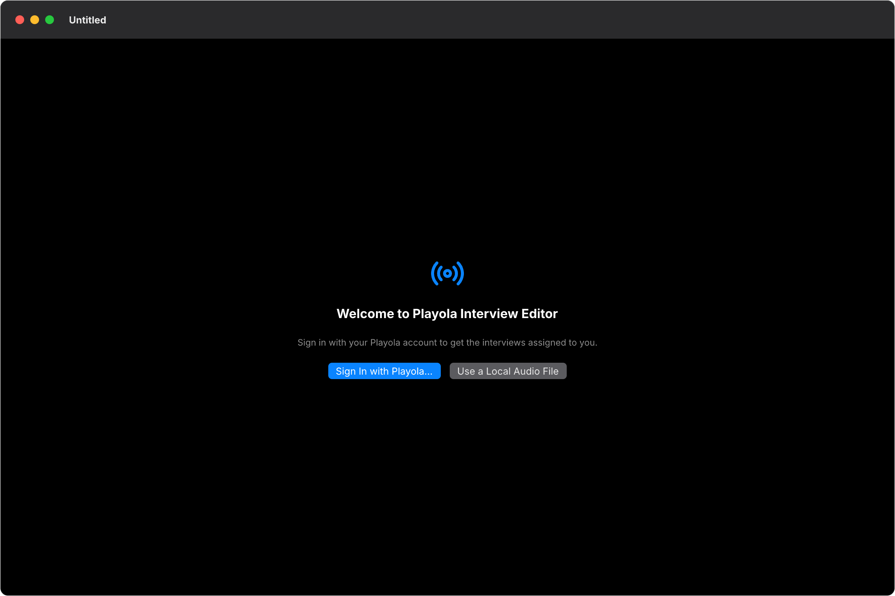
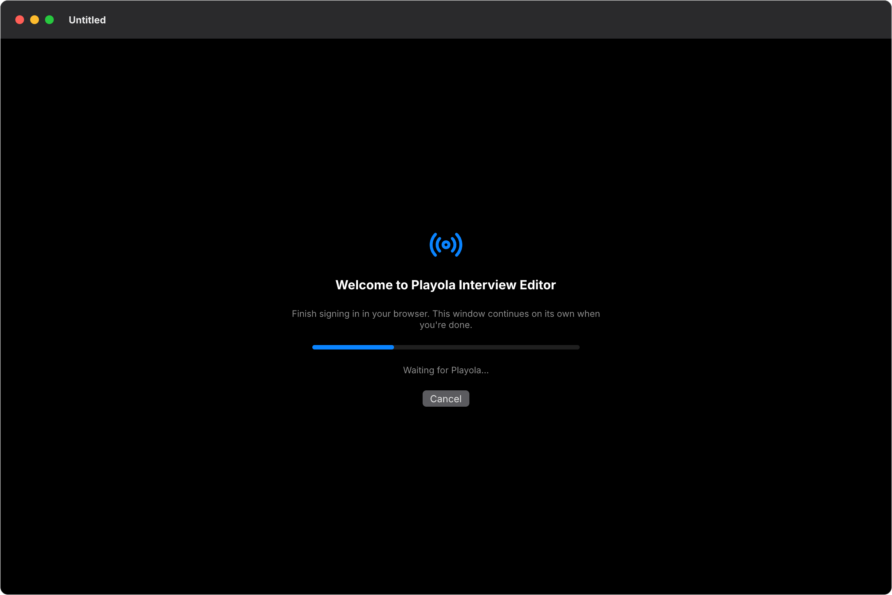
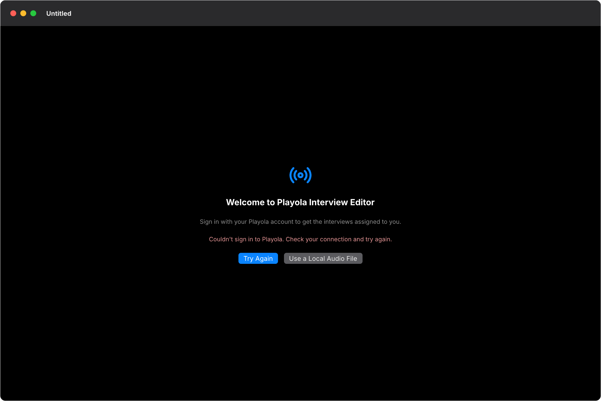
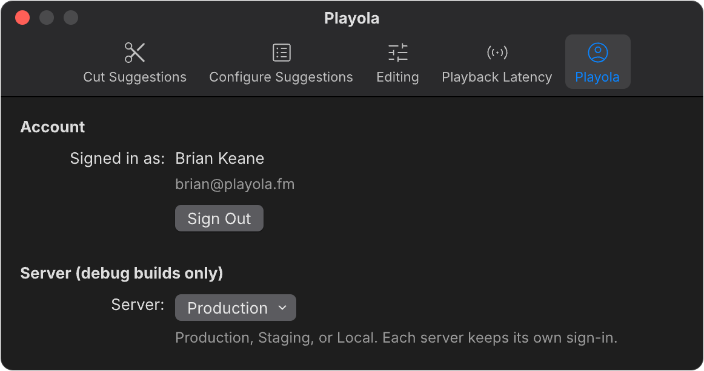
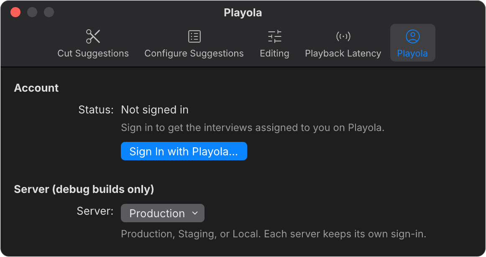

# Playola Sign-in — Screens

Pen file: `design/interview-editor.pen`, section **09 · PROPOSED · Playola sign-in**.
Everything is built from that map's components and screens: the Welcome states are
copies of Model Setup (02.1.1), and the Settings tab is a copy of the Editing tab
(06.3). When this ships, section 09 is folded into sections 02 and 06 and loses its
PROPOSED label.

## Navigation map
| Screen | Surface | Address | Reached from |
|---|---|---|---|
| Welcome | macOS client | n/a (native): content of an empty project window | Launch, File ▸ New, or a Dock click, while signed out |
| Settings ▸ Playola | macOS client | n/a (native): fifth tab of the Settings window | App menu ▸ Settings… (⌘,) → Playola tab |

## Welcome
- **Status:** New
- **Surface:** macOS client
- **Address:** n/a (native). It is shown inside an **empty** project window (one that
  would otherwise show the drop target, 02.1.2) while no one is signed in to Playola.
  It uses the same host gate as Model Setup, so the window is still titled "Untitled".
  A window that already has a project in it never shows Welcome.
- **Access:** anyone signed out of Playola in the active environment
- **Navigated to from:**
  - App launch, File ▸ New (⌘N), or a Dock click with no windows, while signed out
  - Settings ▸ Playola → Sign Out (open empty windows switch to Welcome)
  - Playola rejecting the saved sign-in (401), which shows the "signed out" state
- **Navigates to:**
  - Sign In with Playola… → the browser sign-in, then Model Setup (02.1.1) if the
    speech models are missing, otherwise Project — Empty (02.1.2)
  - Use a Local Audio File → the same: Model Setup (02.1.1) if the speech models are
    missing, otherwise Project — Empty (02.1.2), in this window, exactly as today
  - Cancel (while waiting) → back to Signed out
- **Changed from today:** today a signed-out user sees the drop target (02.1.2)
  directly. That screen is unchanged and is one click away.

| State | When it shows | Node | Mockup |
|---|---|---|---|
| Signed out | No Playola token for the active environment | `kzSyI` |  |
| Waiting for browser | A sign-in attempt is running (browser open, or the code exchange in flight) | `MZ0rl` |  |
| Sign-in failed | The browser returned an error, the code exchange failed, or the network failed | `xdK6E` |  |
| Signed out by Playola | Playola answered 401 to the saved token | `BcAW9` |  |

Canceling in the browser returns to **Signed out** with no error. While the app is still
reading the saved sign-in at launch (milliseconds), an empty window shows only its
background, so a signed-in editor never sees Welcome flash.

## Settings ▸ Playola
- **Status:** New. It is a fifth tab in the existing Settings window, after Playback
  Latency.
- **Surface:** macOS client
- **Address:** n/a (native). App menu ▸ Settings… (⌘,) → Playola tab
- **Access:** everyone
- **Navigated to from:** App menu ▸ Settings… → the Playola toolbar tab
- **Navigates to:**
  - Sign In with Playola… → the same browser sign-in as Welcome. The tab shows the
    waiting and failed text in its Status row.
  - Sign Out → the tab's signed-out state. Open empty windows switch to Welcome. If
    the Keychain refuses the delete, the tab stays signed in and its Status row says
    "Couldn't sign out. Try again."
- **Server picker:** shown only in debug builds. It offers Production, Staging and
  Local, and each server keeps its own sign-in.

| State | When it shows | Node | Mockup |
|---|---|---|---|
| Signed in | A token exists for the active environment | `wrB3j` |  |
| Signed out | No token for the active environment | `PP6TU` |  |

If the account details haven't loaded yet (offline at launch), the signed-in state
shows "Signed in" without the name and email.
